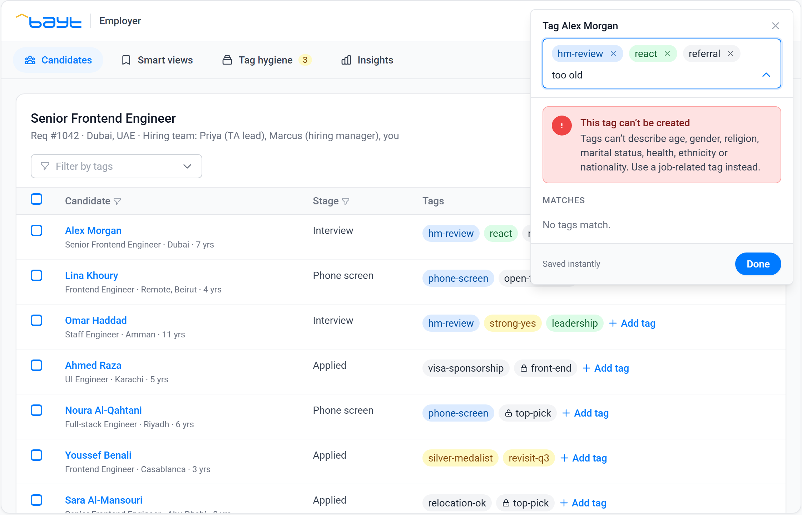
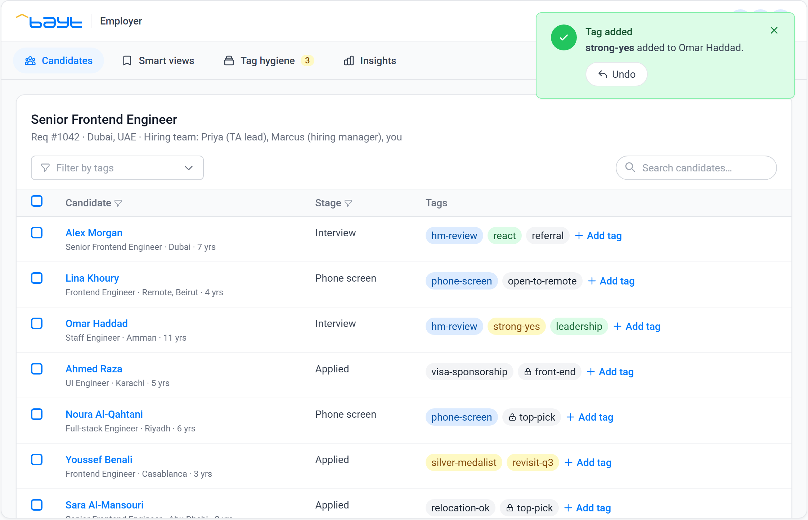
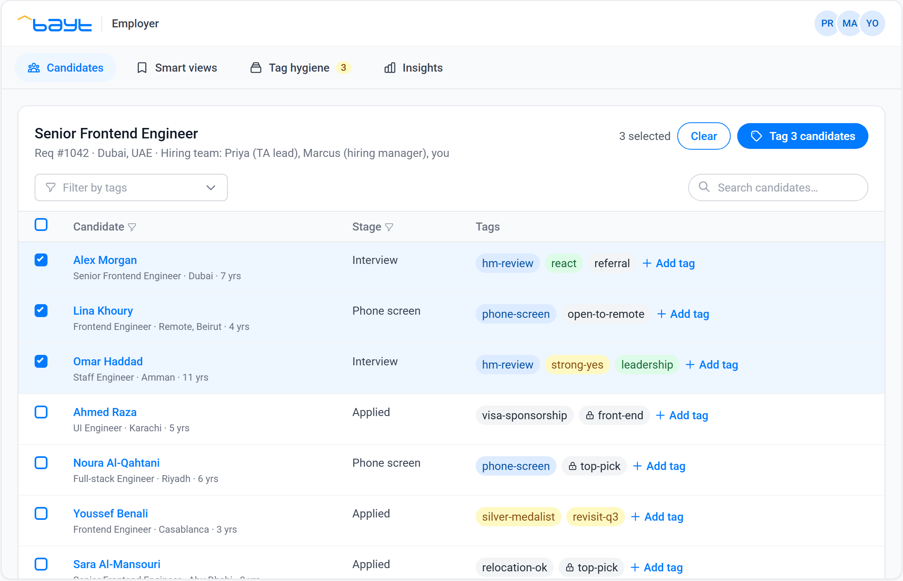

# Unified Tagging System (UTS) for Bayt.com

A concept prototype for a Product Manager case study: a scalable tagging system that lets employers and job seekers on Bayt.com categorise, prioritise and track jobs, candidates and applications, alone or as a team.

**Live prototype:** https://mibbrahim.github.io/unified-tagging-system/

**Case study deck (PDF, 32 slides):** [Unified-Tagging-System-Case-Study.pdf](Unified-Tagging-System-Case-Study.pdf). It covers research, personas, design, architecture, metrics, user testing and scalability testing.


## What the prototype shows

One tag engine serves every surface. Switch **Device** (desktop, tablet, mobile) and **View as** (employer, job seeker) at the top of the page. On a real phone the app opens full screen.

- **Smart suggestions.** Up to five, each with its reason: from the CV or job post, tags the team often uses together, your recent tags.
- **Reuse before create.** Typing `js` finds the existing `javascript` tag through a synonym. Typing `frontnd` shows a warning with a one-tap **Use frontend**.
- **Safe by design.** Tags about age, gender, religion, marital status, health, ethnicity or nationality can't be created. The picker explains why with an error alert.
- **Three scopes.** Platform tags, team tags and personal tags. A lock marks tags only you can see.
- **Recall.** Click any tag to filter the list, then save the filter as a smart view.
- **Bulk tagging.** Select rows and tag them in one step.
- **Undo everywhere.** Every change confirms with an alert that has an Undo button, including merges.
- **Tag hygiene.** Merge duplicates (the old name keeps working as a synonym), archive unused tags, and share popular personal tags with the team.
- **Insights.** Adoption, suggestion acceptance, time to tag, clutter and undo rate, measured live from your session.
- **Adapts per device.** The same picker opens as a dropdown on desktop, a side sheet on tablet and a bottom sheet on phones.

| Tablet | Phone | Phone, job seeker |
|---|---|---|
|  |  |  |

### Alerts

The prototype uses the four alert types from the component library, each for one job:

| Type | Used for |
|---|---|
| Success (green) | A tag added, a view saved, tags merged or shared. Includes Undo. |
| Info (blue) | A tag removed or archived, a change undone. |
| Warning (yellow) | A new tag looks like an existing one. Offers the existing tag. |
| Error (red) | A tag would describe a protected characteristic. Creation is blocked. |








## Things to try

1. Click **Add tag** on Alex Morgan and pick a suggestion, then press **Undo**.
2. Type `js`, then `frontnd`, then `too old`.
3. Click a tag in the grid to filter, then **Save as view**.
4. Tick three candidates and tag them together.
5. Open **Tag hygiene** and merge a duplicate.
6. Switch to **Mobile**, then to **Job seeker**.
7. Open **Insights**.

Keyboard: `T` tags the hovered or selected rows, `/` focuses search, arrow keys and Enter work in the picker, `Esc` closes it.

## Building

`index.html` is a single static file with the CSS already compiled, so it loads fast and needs no build to run. To change it, edit `src/index.src.html` and rebuild:

```bash
npm install -D tailwindcss@3.4.17
python build.py
```

The build compiles Tailwind from `tailwind.config.js` and inlines the CSS and the Bayt.com logo (`assets/bayt-logo.svg`).

## Notes

This is an independent concept prototype made for a job application case study. It is not affiliated with or endorsed by Bayt.com. The Bayt.com name and logo belong to their owner. All people, companies and figures are fictional sample data.

Author: Ibrahim · November 2026
