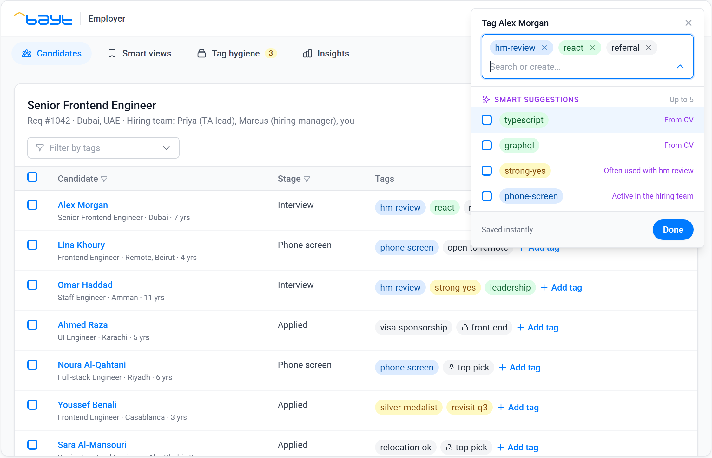
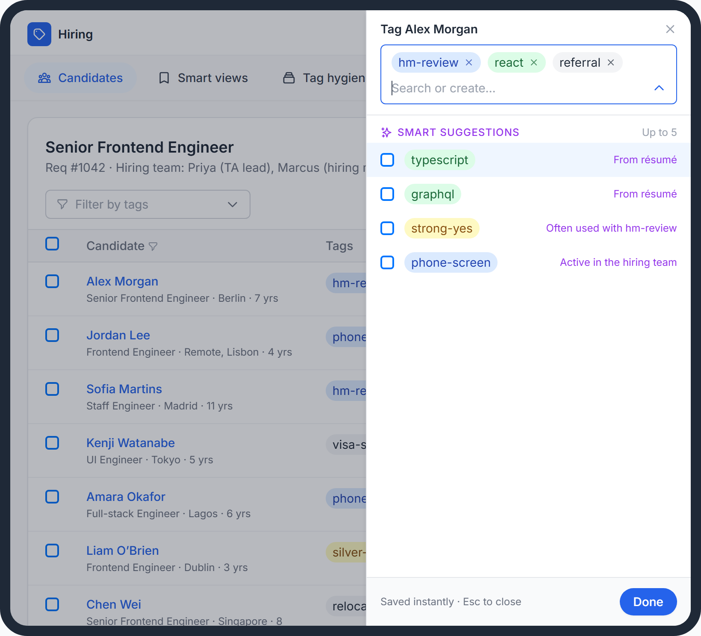
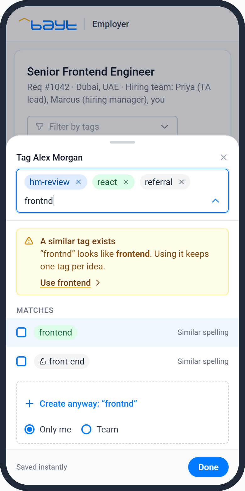
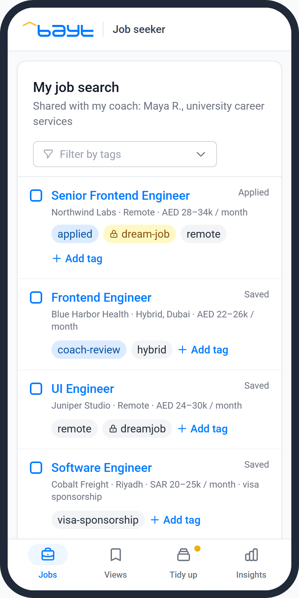
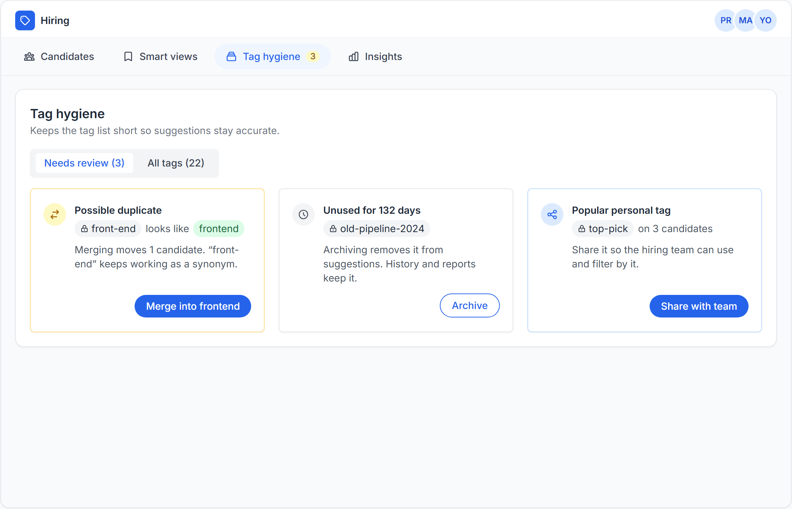
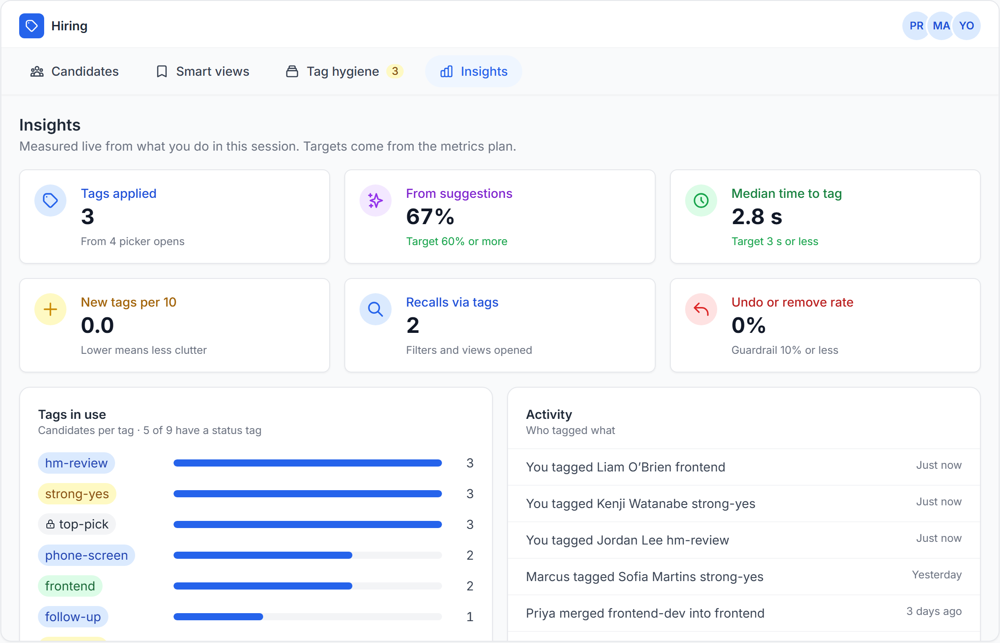

# Unified Tagging System (UTS)

An interactive prototype for a Product Manager case study: a scalable tagging system that lets employers and job seekers on a recruitment marketplace categorise, prioritise and track jobs, candidates and applications, alone or as a team.

**Live prototype:** https://mibbrahim.github.io/unified-tagging-system/

**Case study deck (PDF, 32 slides):** [Unified-Tagging-System-Case-Study.pdf](Unified-Tagging-System-Case-Study.pdf). It covers research, personas, design, architecture, metrics, user testing and scalability testing.

## What the prototype shows

One tag engine serves every surface. Switch **Device** (desktop, tablet, mobile) and **Persona** (hiring team, job seeker) at the top of the page.

- **Smart suggestions.** Up to five, each with its reason: from the résumé or job post, tags the team often uses together, your recent tags.
- **Reuse before create.** Typing `js` finds the existing `javascript` tag through a synonym. Typing `frontnd` warns that `frontend` already exists.
- **Three scopes.** Platform tags, team tags and personal tags. A lock marks tags only you can see.
- **Recall.** Click any tag to filter the list, then save the filter as a smart view.
- **Bulk tagging.** Select several rows and tag them in one step.
- **Tag hygiene.** Merge duplicates (the old name keeps working as a synonym), archive unused tags, and share popular personal tags with the team.
- **Insights.** Adoption, suggestion acceptance, time to tag, clutter and undo rate, measured live from your session.
- **Adapts per device.** The same picker opens as a dropdown on desktop, a side sheet on tablet and a bottom sheet on mobile.

| Tablet | Mobile | Mobile, job seeker |
|---|---|---|
|  |  |  |

## Things to try

1. Click **Add tag** on Alex Morgan and pick a suggestion.
2. Type `js`, then `frontnd`.
3. Click a tag in the grid to filter, then **Save as view**.
4. Tick three candidates and tag them together.
5. Open **Tag hygiene** and merge a duplicate.
6. Switch to **Mobile**, then to **Job seeker**.
7. Open **Insights**.

## Running it

It is a single static file. Open `index.html` in a browser, or serve the folder with any static server. Styling uses Tailwind and the Inter font from public CDNs, so it needs an internet connection.

All people, companies and numbers in the prototype are fictional sample data.

## Author

Ibrahim · Product Manager case study, November 2026
